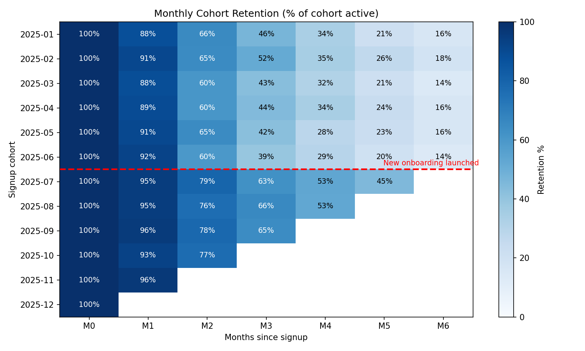

# Case 01 — The Leaking Bucket: Insights & Recommendations

## Executive summary (what you would say to a manager in 30 seconds)
1. **The July onboarding redesign worked.** Month-3 retention rose from about **44% to about 64%**, and it held for every cohort since launch.
2. **Paid Social brings low-quality customers.** Only **23%** are still active at month 3, against **62%** for Referral. Their 6-month revenue is about 40% lower.
3. **Recommendation:** keep the new onboarding, reallocate part of the Paid Social budget toward Referral and Paid Search, and review Paid Social CAC against its lower revenue.

---

## Finding 1 — Onboarding redesign: a measurable win

| Cohorts | M1 | M2 | M3 | M4 | M5 |
|---|---|---|---|---|---|
| Jan–Jun (before) | ~90% | ~63% | ~44% | ~32% | ~23% |
| Jul onwards (after) | ~95% | ~78% | ~64% | ~53% | ~45% |

**Estimated financial impact** (assumptions are stated so stakeholders can challenge them):
- Before, a user averaged about **2.5 active months** in months 1–5. After, about **3.4**. The gain is roughly **0.84 extra active months per user**.
- Revenue per active user-month is **€40.43**, computed from `orders`.
- That gives roughly **€34 extra revenue per new user** in the first 5 months.
- With about **370 signups per month**, that is roughly **€12.5k extra revenue per month, or about €150k per year**, before counting any retention beyond month 5.

**Caveats a good analyst raises:**
- This is a before/after comparison, not an A/B test. Seasonality or a marketing mix change could explain part of the gain. Next step: check whether the channel mix shifted after July, and recommend an A/B holdout for the next product launch.
- Later cohorts have less history (the Dec cohort shows only M0). Never compare M5 for a cohort that is 3 months old.

## Finding 2 — Not all customers are equal: channel quality

| Channel | Users (Jan–Jun) | M1 | M3 | Revenue per user, first 6 months |
|---|---|---|---|---|
| Referral | 424 | 93% | **62%** | €178 |
| Organic | 642 | 93% | 54% | €165 |
| Paid Search | 564 | 88% | 40% | €132 |
| Paid Social | 545 | 86% | **23%** | €106 |

**Business interpretation:**
- At month 1, all channels look similar (86–93%). The differences only appear at month 3. A dashboard that only tracks signups or first-month activity would miss this entirely.
- Marketing usually reports **cost per acquisition**. The real question is **cost per retained customer**. If Paid Social costs the same per signup as Paid Search, it is actually far more expensive per retained customer.
- **Payback logic:** if Paid Social CAC is above about €100, it likely never pays back within 6 months on revenue alone, and less still once margin is applied.

**Recommended next steps:**
1. Get CAC by channel from Marketing and compute **LTV / CAC** per channel (healthy is typically 3:1 or better).
2. Investigate *why* Paid Social users churn: audience targeting, mismatch between ad promise and product, or discount-driven buyers.
3. Expand the referral programme. It has the best retention and is often the cheapest channel.

---

## A real-world data quirk worth knowing
Month 1 retention looks very high (86–96%). This is partly a **calendar-month artifact**: someone who signs up on 28 January and returns on 3 February counts as "retained in month 1" after only 6 days. 

There are two common fixes. One is to use **rolling 30-day windows** instead of calendar months. The other is to define activity as a *meaningful* action, such as a purchase, rather than any login. Always tell stakeholders which definition you used. Teams arguing over conflicting retention numbers are almost always using different definitions.

## Skills demonstrated
`CTEs` · `DISTINCT` aggregation · date arithmetic · conditional aggregation (`CASE WHEN` inside `COUNT`) · pivoting · heatmap visualisation · translating metrics into revenue impact · stating assumptions and caveats
