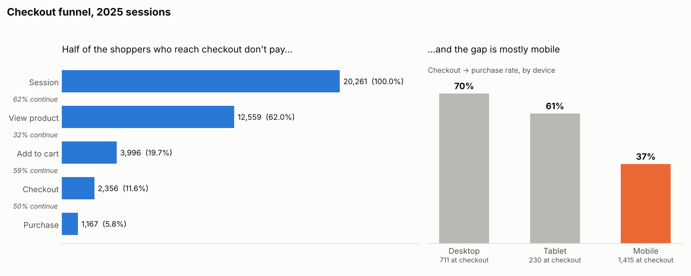

# Case 02 — The Abandoned Checkout: Insights & Recommendations

## Executive summary (30 seconds)
1. **Only 5.8% of sessions end in a purchase.** The biggest single drop is between viewing a product and adding it to the cart (68% leave), but it's the same on every device, so it looks like normal browsing behaviour.
2. **The real problem is mobile payment.** Once at checkout, 70% of desktop shoppers pay, but only **37% of mobile shoppers** do. Mobile accounts for **75% of everyone lost at the payment step** (888 of 1,189 sessions).
3. **Recommendation:** audit the mobile payment page first. Bringing mobile up to tablet level is worth about **€18k a year**; matching desktop, about **€26k**.

---

## Finding 1 — The overall funnel

| Step | Sessions reaching it | Continue from previous step | % of all sessions |
|---|---|---|---|
| Session | 20,261 | — | 100% |
| View product | 12,559 | 62% | 62.0% |
| Add to cart | 3,996 | 32% | 19.7% |
| Checkout | 2,356 | 59% | 11.6% |
| Purchase | 1,167 | 50% | 5.8% |

**Business interpretation:** the largest leak in raw numbers is view → cart: about 8,500 sessions look at a product and leave. That's tempting to chase, but a big drop is not automatically a problem. Many visitors are just browsing or comparing prices. The question to ask is: **is this drop worse in one segment than another?** Here it isn't (30–33% on every device), so there's no obvious broken thing to fix.

## Finding 2 — Mobile shoppers abandon at payment

| Device | Sessions | View | Cart | Checkout | **Purchase** | Reached checkout |
|---|---|---|---|---|---|---|
| Desktop | 6,458 | 62% | 31% | 58% | **70%** | 711 |
| Tablet | 2,034 | 64% | 30% | 59% | **61%** | 230 |
| Mobile | 11,769 | 62% | 33% | 60% | **37%** | 1,415 |

Every step looks the same across devices, **except the last one**. Mobile shoppers want to buy just as much (they reach checkout at the same rate) but fail to complete payment. That pattern points to a **checkout problem, not a demand problem**: a form that's hard to fill on a small screen, a missing mobile wallet such as MB WAY or Apple Pay, a payment redirect that fails, or a page that loads slowly.

Notice how the overall 50% checkout → purchase rate hid this. It averaged a healthy desktop (70%) with a struggling mobile (37%), and mobile is 60% of checkout traffic. This is "aggregate numbers can lie" in action.

**Estimated financial impact** (assumptions stated):
- 1,415 mobile sessions reached checkout in 2025; 527 purchased.
- Average order value is **€55.10** (from `orders`).
- At **tablet level (61%)**: about 335 extra orders → **≈ €18k per year**.
- At **desktop level (70%)**: about 468 extra orders → **≈ €26k per year**.
- This is the cheapest revenue a business can find: these shoppers already chose a product and started paying. No extra marketing spend is needed.

**Caveats a good analyst raises:**
- **Cross-device shopping.** Some people browse on their phone and buy later on a laptop. If so, part of the "lost" mobile sessions are not really lost. Check by user: do mobile abandoners purchase on another device within a few days?
- **Sessions, not people.** One frustrated user retrying three times counts as three abandoned sessions, which could overstate the problem. Repeat the analysis at user level.
- **Seasonality and trend.** Check whether mobile payment conversion dropped suddenly on a date (a release, a new payment provider) or has always been low. A sudden drop points to a bug; a constant gap points to design.

**Recommended next steps:**
1. Ask Engineering for payment error logs by device and browser.
2. Have the UX team complete a purchase on several phones and time it.
3. Fix the most likely cause, then measure it properly with an A/B test (Case 07) rather than a before/after comparison.

---

## The analyst lesson
**The biggest drop is not always the biggest opportunity.** Prioritise the drop that is (a) worse in one segment than others, so something is clearly fixable, and (b) closest to the money, because those people already intend to buy.

## Skills demonstrated
`CASE WHEN` mapping to ordered steps · conditional aggregation in a single pass · `UNION ALL` to shape a report · step rate vs overall rate · segmentation · revenue sizing with stated assumptions · cross-device and unit-of-analysis caveats
