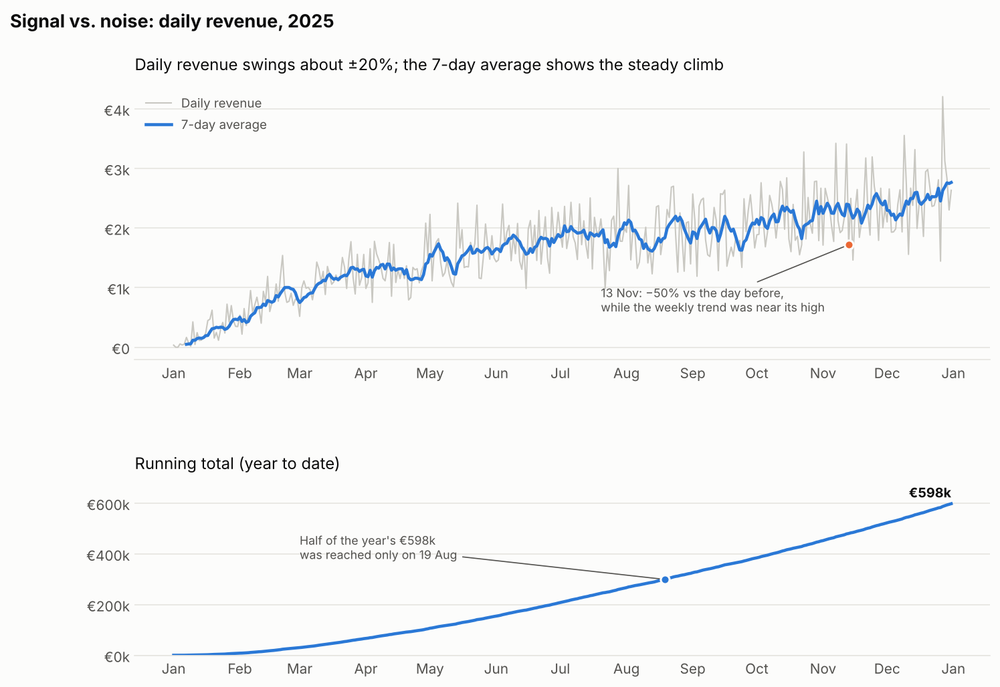

# Case 04 — Signal vs. Noise: Insights & Recommendations

## Executive summary (30 seconds)
1. **One day in four looks like bad news.** On 88 of 351 days (25%), revenue fell more than 20% from the day before. In two-thirds of those cases, the weekly trend was actually rising.
2. **The 7-day average cuts the noise about three times.** Daily revenue varies about ±20% within a month; the 7-day average varies about ±7%. It shows a steady climb from about €1,300 a day in April to about €2,750 a day in December.
3. **Recommendation:** report the 7-day average, not daily revenue, and only investigate a drop when the 7-day average falls clearly below its 28-day average.

---

## Finding 1 — Single days mislead

| | Days | Share |
|---|---|---|
| Days analysed (from 15 Jan) | 351 | 100% |
| Days down more than 20% vs the day before | 88 | 25% |
| …of which the weekly trend was rising | 58 | 66% of those |

**Example — 13 November:** revenue was €1,720, down 50% from €3,412 the day before. Alarming on its own. But the 7-day average that day was €2,394, close to its high for the year. The day before was simply unusually good, and the next day recovered to €2,499.

**Business interpretation:** if a manager reacted to every 20% drop, they'd be investigating a "problem" roughly twice a week, and most of the time there'd be nothing to find. That costs time, and it slowly trains people to ignore alerts, which is dangerous when a real problem does arrive.

## Finding 2 — The trend underneath

| Month | Daily revenue: typical swing | 7-day average: typical swing |
|---|---|---|
| March | ±22% | ±15% |
| June | ±20% | ±6% |
| September | ±23% | ±7% |
| December | ±23% | ±7% |

(Typical swing = standard deviation as a % of the month's average.)

Once the launch months are over, the 7-day average moves about a third as much as daily revenue. It shows the business growing steadily all year, with a flatter stretch from August to September and a clear lift in Q4.

## Finding 3 — The running total: where the year's money came from
- Total 2025 revenue: **€598k**.
- Half of it (€299k) was only reached on **19 August**. In other words, the last 4.5 months earned as much as the first 7.5.
- This matches Case 03: revenue builds as returning customers accumulate, so the year is back-loaded.

**Why Finance cares:** a plan that assumes equal revenue every month (€50k a month) would look like a big miss in the first half and a big win in the second. A better plan follows the growth curve, so progress against it means something.

## A technical trap worth knowing: missing days
On 2 and 3 January there were **no orders**, so those days don't exist in the `orders` table. A "7-day" window that counts the last 7 *rows* would silently stretch over 9 days and skip the two €0 days. On 9 January, that gives €62 a day instead of the correct €57, about 8% too high.

The fix is the **calendar table** in Step 1 of `solution.sql`: generate every date first, then join the orders onto it, with €0 for empty days. In real businesses, missing days come from store closures, tracking outages or holidays, so this mistake is common and can be much larger than 8%.

**Caveats a good analyst raises:**
- **Moving averages react late.** A real problem, like a broken checkout, takes several days to pull the 7-day average down. For urgent issues, also monitor things that react fast, such as payment errors per hour.
- **No weekday pattern in this data.** Real shops usually sell more on some weekdays than others. That's exactly why 7 days is the standard window: each weekday appears once, so the pattern cancels out.
- **The first weeks have very few orders**, so percentages there swing wildly. The analysis starts on 15 January for that reason.

**Recommended next steps:**
1. Replace daily revenue in the management report with the 7-day average plus the year-to-date total.
2. Set an alert only when the 7-day average drops more than, for example, 10% below the 28-day average, and tune that threshold with Operations.
3. Build next year's monthly targets on the growth curve rather than an equal split.

---

## The analyst lesson
**Before reacting to a number, ask how much it normally moves.** A change is only news if it's bigger than the usual wobble. Moving averages show the usual wobble and the direction underneath; running totals show what has built up over time.

## Skills demonstrated
Recursive CTE calendar table · `LEFT JOIN` + `COALESCE` for missing days · window frames (`ROWS BETWEEN n PRECEDING AND CURRENT ROW`) · running totals with `UNBOUNDED PRECEDING` · moving averages · hiding incomplete windows with `COUNT() OVER` · `LAG()` day-over-day comparison · noise measured as standard deviation · alert design
