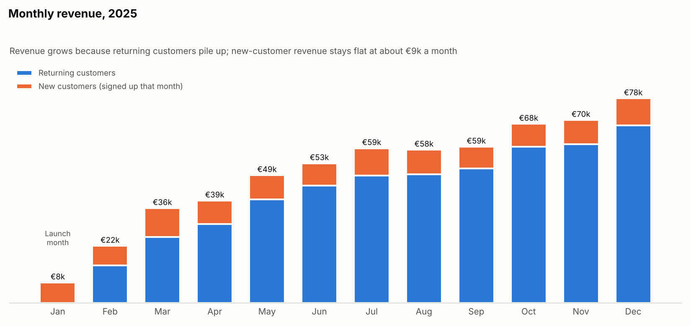

# Case 03 — Is Revenue Really Growing?: Insights & Recommendations

## Executive summary (30 seconds)
1. **Revenue grew from €36k in March to €78k in December**, a steady **8.9% per month**. The early +179% and +66% months are a launch effect, not real momentum.
2. **Almost all growth comes from returning customers.** New-customer revenue is flat at about €9k a month; returning-customer revenue grew from €25k to €68k.
3. **Recommendation:** treat retention as the growth engine. Because signups are flat, growth will slow as the customer base stops expanding, so next year's plan needs a lever: more acquisition, better retention, or bigger baskets.

---

## Finding 1 — Ignore the launch months

| Month | Revenue | MoM growth |
|---|---|---|
| Jan | €7.8k | — |
| Feb | €21.7k | +179% |
| Mar | €36.1k | +66% |
| Apr–Dec | €38.9k → €77.8k | −1% to +25% |

The shop launched in January, so there were no returning customers yet. Any business looks explosive growing from a tiny base. Quoting "+179% growth" in a board deck would be technically true and badly misleading.

A fairer headline uses **CMGR from March to December: 8.9% per month**. In plain terms, revenue grew as if it rose a steady 8.9% every month. Second half revenue (€392k) was 90% higher than the first half (€206k).

## Finding 2 — Part of the zigzag is just the calendar

| Month | Days | MoM growth | MoM growth per day |
|---|---|---|---|
| Sep | 30 | +2.0% | +5.4% |
| Oct | 31 | +14.6% | +10.9% |
| Nov | 30 | +2.2% | +5.6% |
| Dec | 31 | +11.8% | +8.2% |

Growth looks fast in 31-day months and slow in 30-day months, because a longer month simply has more shopping days. Dividing by days in the month (`per_day.sql`) makes the trend much smoother. Before anyone celebrates October or worries about November, check this first. (Case 04 goes further with moving averages.)

## Finding 3 — What is driving the growth

Revenue = buyers × orders per buyer × average order value.

| Driver | March | December | Change |
|---|---|---|---|
| Buyers | 481 | 961 | **×2.0** |
| Orders per buyer | 1.39 | 1.45 | ×1.04 |
| Average order value | €53.90 | €55.79 | ×1.04 |

Nearly all growth comes from **more buyers**. Customers aren't ordering much more often or spending more per order. And those extra buyers are mostly **returning** customers: new-customer revenue stayed at €7–11k every month, because signups stayed flat at about 370 a month.

**Business interpretation:** this business grows by stacking retained customers on top of each other, month after month. That's healthy, but it has a ceiling. With flat signups, the base eventually reaches the point where customers lost each month equal customers gained, and growth flattens. The July onboarding improvement from Case 01 raised that ceiling, which is why it matters so much.

**Sizing the levers** (at the December run rate of about €78k per month):
- **+5% average order value** (bundles, free shipping above a threshold): about **€3.9k more per month, ≈ €47k a year**.
- **+10% buyers** through acquisition or retention: about **€7.8k more per month, ≈ €93k a year**.
- These are rough run-rate estimates to help prioritise, not a forecast.

**Caveats a good analyst raises:**
- **One year of data.** There is no year-over-year comparison yet, so seasonality (Christmas, summer) can't be separated from real growth. December's jump may be partly seasonal. The query already has a YoY column that fills in once a second year exists.
- **Revenue is not profit.** If growth came from heavy discounting, margins could be falling. Ask Finance for gross margin by month.
- **No refunds or cancellations** in this dataset. In real data, always confirm whether revenue is gross or net of returns.

**Recommended next steps:**
1. Report CMGR and per-day revenue to leadership instead of raw MoM percentages.
2. Build a simple forecast showing when growth flattens at current signup and retention rates.
3. Test one AOV lever, for example a free-shipping threshold, with an A/B test (Case 07).

---

## The analyst lesson
**A growth rate needs context before it means anything.** Ask three questions every time: *What was the starting base? Are the periods comparable (same number of days, same season)? Which driver moved?* The answer to the third question tells the business what to do next.

## Skills demonstrated
`LAG()` window function · `LAG(x, 12)` for year-over-year · MoM growth and CMGR · per-day normalisation with date functions · revenue decomposition (buyers × frequency × AOV) · new vs returning split · stacked bar chart · lever sizing with stated assumptions
