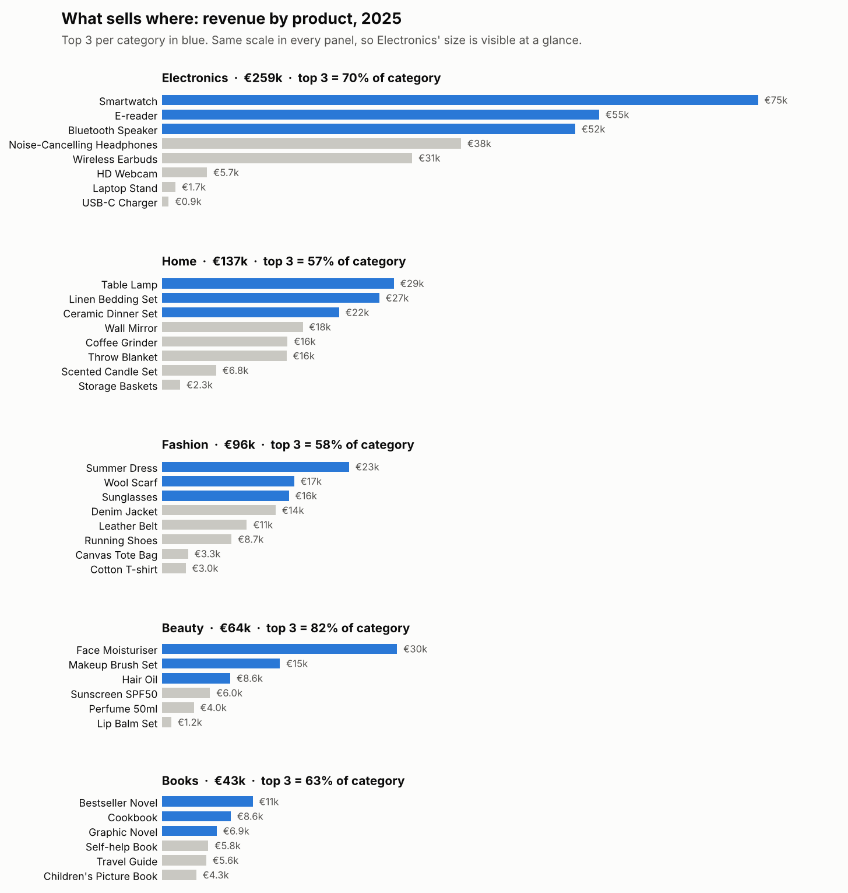

# Case 05 — What Sells Where: Insights & Recommendations

## Executive summary (30 seconds)
1. **Revenue is concentrated.** 17 of the 36 products bring in 80% of revenue, and the bottom 10 bring in only 5%. One product, the Smartwatch, earns €75k: 12.5% of the whole shop.
2. **"Best seller" depends on how you count.** In Home, the Throw Blanket is #3 by number of orders but only #6 by revenue. Ranking by orders would give a homepage slot to a product that earns half as much as the alternative.
3. **Recommendation:** rank homepage products by revenue, use the same top 3 in every country, and use the cheap low sellers as add-ons to reach the free-delivery threshold instead of removing them.

---

## Finding 1 — The top 3 in each category

| Category | Category revenue | #1 | #2 | #3 | Top 3 share |
|---|---|---|---|---|---|
| Electronics | €259k | Smartwatch (€75k) | E-reader (€55k) | Bluetooth Speaker (€52k) | 70% |
| Home | €137k | Table Lamp (€29k) | Linen Bedding Set (€27k) | Ceramic Dinner Set (€22k) | 57% |
| Fashion | €96k | Summer Dress (€23k) | Wool Scarf (€17k) | Sunglasses (€16k) | 58% |
| Beauty | €64k | Face Moisturiser (€30k) | Makeup Brush Set (€15k) | Hair Oil (€8.6k) | 82% |
| Books | €43k | Bestseller Novel (€11k) | Cookbook (€8.6k) | Graphic Novel (€6.9k) | 63% |

**Business interpretation:**
- **Electronics is 43% of the shop's revenue.** Whatever happens to Electronics happens to the business.
- **Beauty depends on one product.** The Face Moisturiser is 46% of Beauty revenue. If it went out of stock for a month, Beauty would lose almost half its sales. That's a supply risk for Purchasing to manage, for example with a second supplier or a larger safety stock.
- **Home and Fashion are spread out.** Their top 3 make up less than 60%, so no single product is critical.

## Finding 2 — Orders vs revenue: two different "best sellers"

| Category | Product | Price | Rank by orders | Rank by revenue |
|---|---|---|---|---|
| Home | Throw Blanket | €45 | **3** | 6 |
| Home | Wall Mirror | €69 | 6 | **4** |
| Books | Graphic Novel | €24 | 5 | **3** |
| Books | Children's Picture Book | €14 | **4** | 6 |

Cheaper products climb when you count orders; pricier ones climb when you count revenue. Neither ranking is "wrong", but they lead to different homepages. Revenue is the better default for limited homepage space, because each slot should earn as much as possible. Orders are useful for other decisions, such as stock planning and delivery capacity.

## Finding 3 — The same winners in every market

In 4 of 5 categories, the #1 product is the same in all six countries. Only Home differs: the Table Lamp wins in Brazil, France and Germany, and the Linen Bedding Set in Angola, Portugal and Spain.

But the gap is often tiny: in Spain, €4,402 vs €4,349 (1%), and in Angola 5%. Each product sells only about 50–100 orders per country, so small differences can easily flip by chance. Overall, the Lamp leads by 7%.

**Business interpretation:** there's no evidence that markets want different products. One homepage for all countries is simpler and well supported by the data. Re-check this if a country's volume grows enough to show a clear, lasting difference.

## Finding 4 — The long tail: don't delete it yet
The 10 lowest-earning products bring in only 5.3% of revenue. Several are cheap items: USB-C Charger (€29), Lip Balm Set (€12), Storage Baskets (€29), Canvas Tote Bag (€25), Cotton T-shirt (€22).

Removing them would barely affect revenue, but there's a better use: these are ideal **add-on products**. The Case 03 extension recommended a free-delivery threshold just above the €55 average order. A customer at €48 needs a €12 lip balm or a €22 T-shirt to qualify. Showing cheap add-ons in the basket turns the long tail into a tool for raising average order value.

**Caveats a good analyst raises:**
- **Revenue is not profit.** A product with high revenue but thin margin may be worth less than it looks. Rank by gross margin when cost data is available.
- **Low sales may mean low visibility.** A product buried on page 5 can't sell. Check product page views before concluding that nobody wants it.
- **One product per order.** Real shops have baskets with several items, stored in an order-items table. The same queries work there, summing item revenue instead of order amount.

**Recommended next steps:**
1. Feature the top 3 by revenue per category on the homepage, reviewed monthly.
2. Ask Purchasing to protect stock for the Smartwatch and Face Moisturiser.
3. Test a "complete your order" add-on box with the low-price products, measured with an A/B test (Case 07).

---

## SQL focus: ROW_NUMBER vs RANK vs DENSE_RANK
`rank_functions.sql` lists the most expensive products. Several share a price, which shows the difference:

| Product | Price | ROW_NUMBER | RANK | DENSE_RANK |
|---|---|---|---|---|
| Wireless Earbuds | €79 | 7 | 7 | 7 |
| Ceramic Dinner Set | €79 | 8 | 7 | 7 |
| HD Webcam | €69 | 9 | 9 | 8 |
| Wall Mirror | €69 | 10 | 9 | 8 |
| Denim Jacket | €69 | 11 | 9 | 8 |
| Perfume 50ml | €65 | 12 | 12 | 9 |

- **ROW_NUMBER** never repeats. Ties get different numbers in an arbitrary order. Use it when you need **exactly N rows**, such as exactly 3 homepage slots.
- **RANK** gives ties the same number, then skips, like a race where two runners share 7th place and the next one is 9th.
- **DENSE_RANK** gives ties the same number without skipping. Use it for "the top 3 price levels".

Interviewers ask about this difference constantly, so it's worth knowing by heart.

## The analyst lesson
**Agree on the ranking metric before ranking.** "Top products" by orders and by revenue are different lists, and the right one depends on the decision being made.

## Skills demonstrated
`ROW_NUMBER()`, `RANK()`, `DENSE_RANK()` · `PARTITION BY` to rank within groups · top-N per group with an outer filter · `SUM() OVER (PARTITION BY)` for share of group · multi-table `JOIN`s · comparing two rankings · concentration (Pareto) analysis · separating real differences from small-sample noise

---

## Extension
[My follow-up analysis: the best-selling product in each country](my_analysis_top_product_by_country.md). It finds the Smartwatch is the top earner in all six countries, even where other products are ordered more often, and sizes the stock risk.
