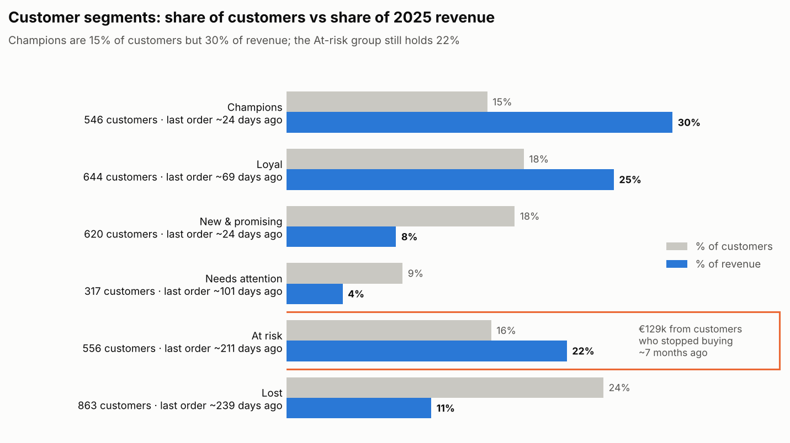

# Case 06 — Know Your Customers: Insights & Recommendations

## Executive summary (30 seconds)
1. **A third of customers bring in more than half the revenue.** Champions and Loyal customers are 34% of buyers but 55% of 2025 revenue.
2. **€129k came from customers who have stopped buying.** The 556 "At risk" customers ordered 4 times on average and spent €231 each, but their last order was about 7 months ago. They are the biggest opportunity in this analysis.
3. **Recommendation:** run a win-back campaign for At-risk customers first, protect Champions with recognition rather than discounts, and stop spending on Lost customers. Bringing back 10% of the At-risk group is worth roughly €13k a year.

---

## Finding 1 — The segments

| Segment | Customers | % of customers | 2025 revenue | % of revenue | Last order (avg) | Orders (avg) | Spend (avg) |
|---|---|---|---|---|---|---|---|
| Champions | 546 | 15% | €177k | **30%** | 24 days ago | 5.9 | €324 |
| Loyal | 644 | 18% | €150k | 25% | 69 days ago | 4.2 | €233 |
| New & promising | 620 | 18% | €50k | 8% | 24 days ago | 1.5 | €81 |
| Needs attention | 317 | 9% | €26k | 4% | 101 days ago | 1.4 | €82 |
| **At risk** | **556** | 16% | **€129k** | **22%** | **211 days ago** | 4.2 | €231 |
| Lost | 863 | 24% | €66k | 11% | 239 days ago | 1.4 | €77 |

**Business interpretation:**
- **Champions** spend 4 times more than the average Lost customer. Losing one Champion costs as much as losing four ordinary customers.
- **At risk and Loyal look almost identical on paper** (4.2 orders, about €230 each). The only difference is time: Loyal customers ordered about 2 months ago, At-risk customers about 7. That's what makes them worth saving. They have already shown they like the shop.
- **Lost customers** mostly bought once, cheaply, long ago. Spending money to win them back rarely pays.

## Finding 2 — The right action for each segment

| Segment | Goal | Action | What NOT to do |
|---|---|---|---|
| Champions | Keep them | Early access, thank-you notes, loyalty perks | Don't give discounts they don't need |
| Loyal | Move them up | Personalised recommendations, bundles | Don't over-email |
| New & promising | Get the 2nd and 3rd order | Welcome series, "you might also like" | Don't treat them as loyal yet |
| Needs attention | Re-engage early | Reminder with new arrivals | Don't wait until they're lost |
| **At risk** | **Win back** | **Personal "we miss you" offer** | **Don't ignore them; they were good customers** |
| Lost | Low-cost reactivation only | One automated email, then stop | Don't spend on paid ads to reach them |

**Sizing the win-back** (assumptions stated so they can be challenged):
- 556 At-risk customers each spent €231 on average in 2025.
- If a win-back campaign brings back **10%** (about 56 customers) to the same spending level for a year, that's about **€13k**.
- Emails cost almost nothing, so even a lower success rate pays off. A discount would need to stay well below the extra revenue it brings in.

## Finding 3 — Where the best and worst customers come from

| Channel | Sign-ups | Never ordered | Became Champions | Became Lost |
|---|---|---|---|---|
| Referral | 878 | 15% | **19%** | 14% |
| Organic | 1,300 | 16% | 15% | 17% |
| Paid Search | 1,119 | 20% | 11% | 22% |
| Paid Social | 1,109 | **26%** | **5%** | **25%** |

This is Case 01's finding seen from another angle: Paid Social brings customers who often never order, rarely become Champions, and are most often lost. A Referral sign-up is almost **4 times** more likely to become a Champion than a Paid Social one.

There's also a group RFM doesn't show at all: **860 people (20% of sign-ups) never placed an order.** That's an activation problem, a job for the welcome journey rather than for RFM.

## A technical trap worth knowing: NTILE and ties
`NTILE(5)` splits customers into five equal-sized groups. That works for spend and recency, which have many different values. It fails for frequency: 1,021 customers (29%) ordered exactly once, more than fit in one group of about 709.

`ntile_trap.sql` shows what happens:

| Orders | NTILE score | Customers |
|---|---|---|
| 1 | 1 | 710 |
| 1 | **2** | 311 |
| 2 | 2 | 398 |
| 2 | **3** | 381 |

Customers with the **same** number of orders get **different** scores, just to keep the groups equal. 311 one-order customers would be scored like two-order customers, by chance. The fix is fixed thresholds with `CASE WHEN` (1, 2, 3, 4–5, 6+ orders), so the same behaviour always gets the same score.

**Caveats a good analyst raises:**
- **Segment rules are choices, not facts.** Moving a threshold moves customers between segments. Agree the rules with the CRM team and keep them stable so segments can be compared month to month.
- **Recency depends on the snapshot date and on how often people normally buy.** Seven months without an order is alarming for a shop where customers buy every 2 months; it's normal for a furniture store. Check the typical gap between orders before labelling anyone "at risk".
- **Early customers had more time to drift away.** Someone who signed up in January had 12 months to become At risk; someone who signed up in October couldn't yet. Case 01's cohorts help separate those effects.
- **Monetary value is revenue, not profit.** Champions who only buy on discount may be less valuable than they look.

**Recommended next steps:**
1. Launch a win-back email for the 556 At-risk customers, with a control group that gets nothing, so the real effect can be measured (Case 07).
2. Refresh the segments monthly and track how many customers move up or down.
3. Share the channel results with Marketing alongside Case 01: they point the same way.

---

## The analyst lesson
**Group customers by what they do, then give each group a different action.** A segmentation is only useful if every segment comes with a clear "so what": who to keep, who to win back, and who to let go.

## Skills demonstrated
RFM segmentation · `NTILE()` for quantile scores · `CASE WHEN` thresholds and segment rules · date arithmetic with `julianday()` · `SUM() OVER ()` for share of total · `LEFT JOIN` to include customers with no orders · spotting the NTILE ties problem · segment-to-action mapping · win-back sizing with stated assumptions
