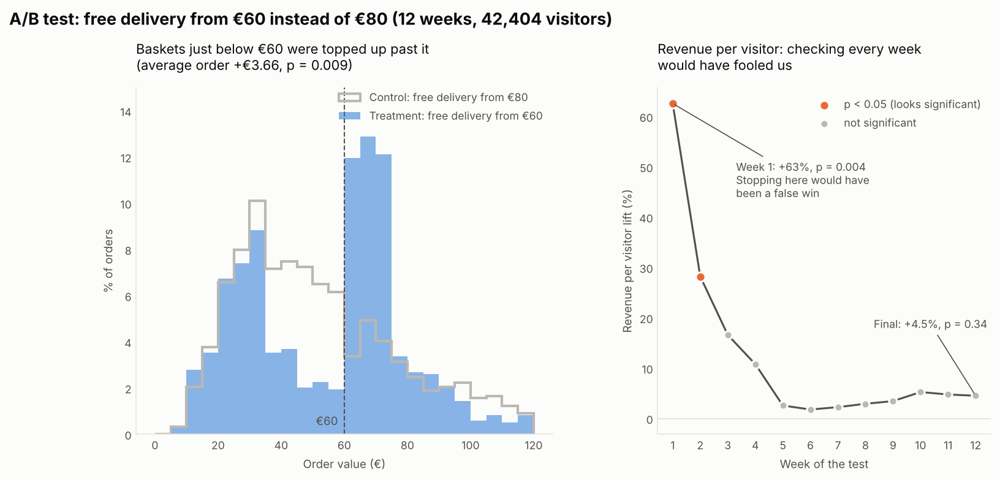

# Case 07 — Did It Actually Work?: Insights & Recommendations

## Executive summary (30 seconds)
1. **Customers did spend more per order.** Average order value rose from €56.40 to €60.06 (+€3.66, p = 0.009). Baskets just below €60 were topped up past it.
2. **But revenue per visitor did not clearly improve.** It rose 4.5%, but the result is not statistically significant (p = 0.34), and proving an effect that small would take about two years of traffic.
3. **And it costs money.** Free deliveries jumped from 19% to 57% of orders. After delivery costs, profit per visitor *fell* by about 3%.
4. **Recommendation:** don't roll out the €60 threshold as tested. Test a higher threshold (around €65–70) or a reduced delivery fee instead, with profit per visitor as the primary metric.

---

## Step 1 — Can we trust the split?
Control had 21,251 visitors and treatment 21,153: 50.1% vs 49.9%. A chi-square test gives p = 0.63, so the split looks healthy.

**Why this check comes first:** if a bug sent, say, more mobile users to one group, the groups wouldn't be alike any more, and every other result would be unreliable. This problem is called a *sample ratio mismatch*. Always check it before looking at the results.

## Step 2 — The results

| Metric | Control (€80) | Treatment (€60) | Difference | 95% confidence interval | p-value | Verdict |
|---|---|---|---|---|---|---|
| Conversion rate | 5.72% | 5.62% | −0.11 pts | −0.55 to +0.33 pts | 0.64 | No clear change |
| Average order value | €56.40 | €60.06 | **+€3.66** | **+€0.93 to +€6.39** | **0.009** | **Real increase** |
| Revenue per visitor | €3.227 | €3.373 | +€0.146 (+4.5%) | −€0.153 to +€0.446 | 0.34 | Not proven |
| Orders with free delivery | 19.2% | 56.9% | +37.7 pts | | | Much higher cost |

**How to read the confidence interval:** it's the range where the true effect probably lies. For AOV it's entirely above zero, so we're confident baskets grew. For revenue per visitor it runs from a loss to a gain, so the data is consistent with no effect at all.

## Step 3 — Where the bigger baskets came from

| Order value | Control | Treatment |
|---|---|---|
| Under €35 | 31% | 30% |
| **€35 to €59.99** | **35%** | **13%** |
| **€60 to €79.99** | **16%** | **40%** |
| €80 and over | 19% | 17% |

The threshold worked exactly as intended: orders moved from just below €60 to just above it, and small baskets under €35 were unaffected. The mechanism is real.

## Step 4 — The profit check
Revenue isn't profit. Assuming a 40% gross margin and €4.50 delivery cost per free delivery the shop pays:

| | Control | Treatment |
|---|---|---|
| Gross margin per visitor | €1.291 | €1.349 |
| Delivery cost per visitor | €0.049 | €0.144 |
| **Profit per visitor** | **€1.242** | **€1.205** |

The extra margin from bigger baskets (+€0.06 per visitor) is smaller than the extra delivery cost (+€0.10). Most customers who now get free delivery would have spent over €60 anyway, or only added a few euros. At the test's traffic (about 184k visitors a year), that's roughly **€7k less profit per year**, under these assumptions.

## Step 5 — The peeking trap

| After week | Revenue per visitor lift | p-value |
|---|---|---|
| 1 | **+63%** | **0.004** |
| 2 | +28% | 0.031 |
| 3 | +17% | 0.10 |
| 6 | +2% | 0.79 |
| 12 (planned end) | +4.5% | 0.34 |

After the first week, the treatment looked like a huge, "statistically significant" win. If the team had stopped the test there, they'd have rolled out a change that doesn't pay off.

**Why this happens:** in the first week each group had only about 1,750 visitors and 100 orders, so a few big orders can swing the average wildly. And checking every week gives luck many chances to produce a p-value under 0.05. The fix is simple: **decide the test length in advance and only judge the result at the end.**

## Step 6 — Could we just run it longer?
To prove a +€0.146 lift in revenue per visitor with the usual standards (80% power, 5% significance), we'd need about **182,000 visitors per variant**: around **two years** of traffic. The effect is real for basket size but too small, relative to the noise in revenue, to be worth waiting for. And the profit check already points the wrong way.

**Caveats a good analyst raises:**
- **Margin and delivery cost are assumptions.** With a higher margin or cheaper delivery, the profit result could flip. Confirm the real figures with Finance and Logistics.
- **One metric decides.** Testing many metrics and celebrating whichever looks good is another form of peeking. Revenue per visitor (or better, profit per visitor) should be chosen as the primary metric before the test starts.
- **Customers may adapt over time.** Twelve weeks may not show long-term effects, such as regulars learning to bundle orders.

**Recommended next steps:**
1. Keep the €80 threshold for now.
2. Test a threshold around €65–70, so fewer orders that would have been large anyway get free delivery, or a reduced delivery fee instead of free delivery.
3. Make **profit per visitor** the primary metric, and calculate the required test length *before* starting.
4. Combine any new threshold with add-on suggestions (the cheap products from Case 05) to make topping up easier.

---

## The analyst lesson
**A test can "work" and still be a bad idea.** The threshold changed customer behaviour exactly as intended, but the business result depends on revenue *and* costs. And never stop a test the moment it looks good: early results are the least reliable ones.

## Skills demonstrated
A/B test design · sample ratio mismatch check (chi-square) · two-proportion z-test · Welch's t-test · confidence intervals · choosing a primary metric · distribution comparison · profit analysis with stated assumptions · peeking / early-stopping bias · power and sample-size calculation · Python (`pandas`, `scipy`) alongside SQL
